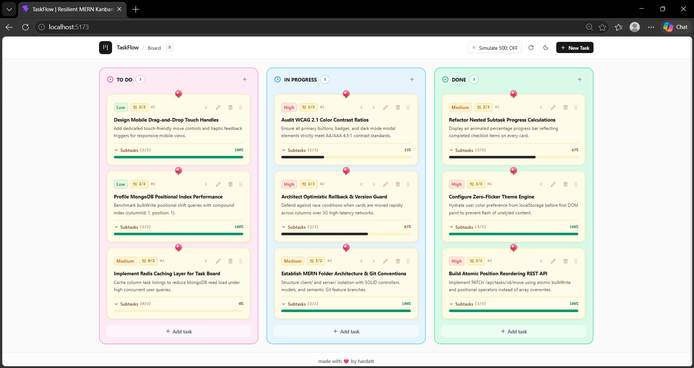
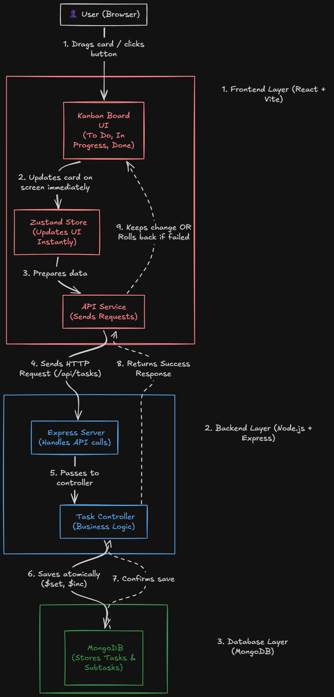

# TaskFlow - Resilient MERN Kanban Board Application

TaskFlow is a production-grade, highly resilient Kanban Board Application built with the **MERN Stack** (MongoDB, Express, React, Node.js) and styled with **Tailwind CSS**. It emphasizes **SOLID architectural principles**, clean modular JavaScript (ES6+), **atomic database persistence**, **optimistic UI updates with instant rollback**, and **zero-flicker theme persistence**.



---

## Architecture Diagram:




##  Key Highlights & Architectural Features

1. **Atomic Persistence & Bulk Operations**:
   - Reordering and cross-column card moves use MongoDB `bulkWrite` with `$inc` and `$set` atomic operators rather than naive array overwrites, preventing race conditions and index corruption.
2. **Optimistic UI with Graceful Rollback**:
   - Card movements update the client UI in 0ms without waiting for backend network roundtrips.
   - If an API call fails or encounters network drops, an immutable snapshot reverts the card to its original position instantly and displays an accessible Toast error.
3. **Interactive 500 Simulation Toggle**:
   - A dedicated **"Simulate 500 Error"** switch in the application header allows evaluators to simulate server failure on the fly and verify optimistic rollback in real-time with one click.
4. **Zero-Flicker Theme Engine**:
   - Light and Dark modes with WCAG 2.1 AA/AAA compliant color contrast.
   - Instant theme hydration via an inline script before the DOM paints, preventing flash of unstyled content (FOUC) on browser refresh.
5. **Wildcard Feature (Option 3: Nested Checklist & Progress)**:
   - Cards support subtasks with completion toggles, quick addition/removal, and an animated progress bar indicating percentage completion.
6. **Comprehensive Architectural Documentation**:
   - Complete technical breakdown in [`DECISIONS.md`](./DECISIONS.md) addressing state management selection, 3G race condition defense, AI hallucination debugging, and 50k task high-scale re-architecture.

---

##  Project Architecture & Directory Structure

```text
kanban/
├── client/                     # Frontend (React 19, Vite, Tailwind CSS, Zustand)
│   ├── public/
│   │   └── favicon.svg         # Application icon
│   ├── src/
│   │   ├── components/
│   │   │   ├── Board.jsx       # Kanban board grid orchestrator
│   │   │   ├── Column.jsx      # Drop zone, card list, quick add
│   │   │   ├── Card.jsx        # Draggable card with subtask checklist & progress bar
│   │   │   ├── Header.jsx      # Brand, theme toggle, 500 simulation switch
│   │   │   ├── TaskModal.jsx   # Create & Edit task dialog
│   │   │   └── Toast.jsx       # Alert notification system
│   │   ├── hooks/
│   │   │   └── useTheme.js     # Zero-flicker theme engine hook
│   │   ├── services/
│   │   │   └── api.js          # REST API client with error handling
│   │   ├── store/
│   │   │   └── useTaskStore.js # Zustand store (Optimistic UI, FIFO queue, rollback)
│   │   ├── App.jsx             # Main layout & orchestration
│   │   ├── index.css           # Tailwind base, dark mode tokens, scrollbars
│   │   └── main.jsx            # Application entry point
│   ├── index.html              # Zero-flicker hydration script & Google Fonts
│   ├── package.json
│   ├── postcss.config.js
│   ├── tailwind.config.js
│   └── vite.config.js
│
├── server/                     # Backend (Node.js, Express, MongoDB, Mongoose)
│   ├── config/
│   │   └── db.js               # MongoDB connection handler
│   ├── controllers/
│   │   └── taskController.js   # CRUD & atomic bulk reordering logic
│   ├── middleware/
│   │   └── errorHandler.js     # Centralized API error handler
│   ├── models/
│   │   └── Task.js             # Task schema with subtasks & compound indexes
│   ├── routes/
│   │   └── taskRoutes.js       # RESTful Express route definitions
│   ├── .env.example            # Environment template
│   ├── package.json
│   ├── seed.js                 # Database reset & population script
│   └── server.js               # Express application entry point
│
├── .env.example                # Root environment template
├── .gitignore                  # Git ignore rules
├── DECISIONS.md                # Architectural decisions & scaling analysis
├── package.json                # Root package with concurrently scripts
└── README.md                   # Documentation & evaluation instructions
```

---

##  Quick Start & Run Instructions

### 1. Prerequisites
- **Node.js**: v18.0.0 or higher (v22.x recommended)
- **MongoDB**: Local MongoDB instance running on `localhost:27017` or a MongoDB Atlas URI

### 2. Environment Setup
Create environment files from the provided templates:
```bash
# In the root directory
cp .env.example .env

# In the server directory
cp server/.env.example server/.env
```

Default configuration in `server/.env`:
```env
PORT=5000
MONGODB_URI=mongodb://127.0.0.1:27017/taskflow
CLIENT_URL=http://localhost:5173
NODE_ENV=development
```

### 3. Install Dependencies
Run the install command from the root directory:
```bash
npm run install:all
```
*(Or install manually in both `server/` and `client/` using `npm install`)*.

### 4. Seed the Database (`npm run seed`)
Execute the one-command database seeder from root:
```bash
npm run seed
```
This script resets the MongoDB `tasks` collection and populates it with 9 realistic cards across **To Do**, **In Progress**, and **Done** with varied priorities, subtask checklists, and sequential position ordering.

### 5. Launch the Application
Start both the backend server and frontend client concurrently:
```bash
npm run dev
```

- **Frontend Client**: [http://localhost:5173](http://localhost:5173)
- **Backend API**: [http://localhost:5000/api/tasks](http://localhost:5000/api/tasks)
- **Health Check**: [http://localhost:5000/api/health](http://localhost:5000/api/health)

---

##  Evaluator Verification Guide

### 1. Testing Optimistic UI & Graceful Rollback
1. Open the app in your browser at [http://localhost:5173](http://localhost:5173).
2. In the top navigation bar, click the **"Simulate 500 Error: OFF"** button to toggle it to **"ON"** (turns rose red).
3. Drag any card from **To Do** to **In Progress** or click the move arrow button.
4. **Observe**:
   - The card instantly moves to the target column (optimistic update).
   - Within milliseconds, the backend returns HTTP 500 (`SIMULATED_SERVER_ERROR`).
   - The card automatically snaps back to its original column and position.
   - A rose-colored error Toast appears alerting you: *"Move failed: SIMULATED_SERVER_ERROR... State restored."*
5. Toggle **"Simulate 500 Error"** back to **"OFF"** and drag again; the card moves and persists permanently.

### 2. Testing Nested Checklist & Progress Bar (Wildcard Feature)
1. Locate any card with a checklist (e.g., *"Architect Optimistic Rollback & Version Guard"*).
2. Notice the percentage badge and animated progress bar (e.g., `67%`).
3. Click the checklist toggle arrow or subtask pill badge to expand the checklist.
4. Check or uncheck subtasks; the progress bar smoothly animates its width and color in real time.
5. Use the inline **"+ Add Subtask"** input to add a new item or click the trash icon to delete an item.

### 3. Testing Zero-Flicker Light / Dark Mode
1. Click the Sun/Moon icon in the top header. The interface immediately transitions to Dark Mode.
2. Refresh the browser page (`F5` or `Ctrl+R`).
3. **Notice**: The page renders directly in dark mode with **zero white flash** before paint.

---

##  REST API Reference

| Method | Endpoint | Description |
| :--- | :--- | :--- |
| `GET` | `/api/tasks` | Fetch all tasks ordered by `columnId` and `position` ASC |
| `POST` | `/api/tasks` | Create a new task (auto-positions at end of column) |
| `PUT` | `/api/tasks/:id` | Update task details (`title`, `description`, `priority`) |
| `PATCH` | `/api/tasks/:id/move` | Atomically reorder task within or across columns |
| `DELETE` | `/api/tasks/:id` | Delete task and atomically re-index subsequent cards |
| `POST` | `/api/tasks/:id/subtasks` | Add a nested subtask item to a card |
| `PATCH` | `/api/tasks/:id/subtasks/:subtaskId` | Toggle completion or edit a subtask |
| `DELETE` | `/api/tasks/:id/subtasks/:subtaskId` | Remove a subtask from a card |
| `GET` | `/api/health` | Service health status and uptime |

---

##  Git Branching Strategy & Conventions

The repository follows a strict Git feature-branch workflow merged into `main`:
- `feature/kanban-crud`: Mongoose schemas, database seeder, REST API, board layout, and CRUD operations.
- `feature/theme-support`: Light/Dark mode engine, WCAG contrast compliance, and zero-flicker hydration.
- `feature/wildcard-checklist`: Nested subtask checklists and animated completion percentage progress bar.
- `feature/optimistic-ui`: Instant client updates, graceful rollback, rapid interaction FIFO queue, and 500 error simulation hook.

All commit messages adhere to conventional standards:
`feat: ...`, `fix: ...`, `chore: ...`.
